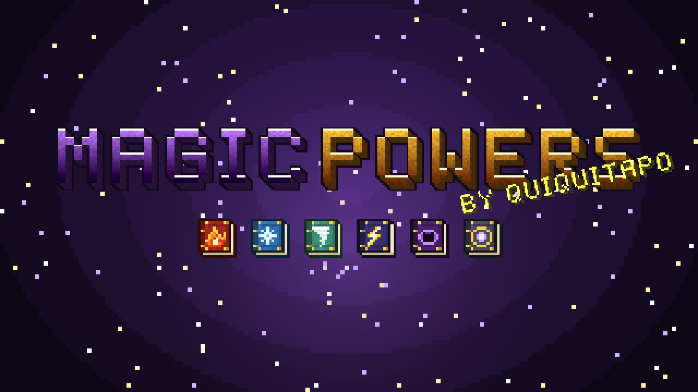

# MagicPowers By Quiquitapo



**Domina los elementos.** MagicPowers añade a Minecraft Bedrock cinco libros mágicos
(**Fuego, Hielo, Viento, Electricidad y Gravedad**) que se fabrican en supervivencia, cada
uno con **4 habilidades** que se desbloquean al subir de nivel el libro derrotando enemigos.
Además, el **Libro Mágico Vacío** te permite crear tu propio grimorio: gastas niveles de
experiencia para escribir en él, en orden, los hechizos que prefieras de los demás libros.
Todo mantiene el estilo vanilla: texturas pixel-art de 16×16, sonidos del juego y un panel
discreto en una esquina de la pantalla.

> **Descripción corta (para la tienda o MCPEDL):**
> *Fabrica libros mágicos de Fuego, Hielo, Viento, Electricidad y Gravedad con 4 habilidades
> cada uno: llamaradas, lluvias de meteoros, estacas de hielo, ventiscas, tornados, rayos en
> cadena, rocas colosales y mucho más. Derrota enemigos para subir de nivel tus libros, o
> gasta tu experiencia en el Libro Mágico Vacío para crear tu propio grimorio con tus
> hechizos favoritos. Por Quiquitapo.*

---

## Requisitos

| | |
|---|---|
| Edición | Minecraft **Bedrock** (Windows, Android, iOS, consolas) |
| Versión mínima | **1.26.50** (la última estable, del 15‑09‑2026) |
| API de scripts | `@minecraft/server` **2.10.0** y `@minecraft/server-ui` **2.2.0** (estables, no necesitan experimentos) |

## Instalación

1. Descarga **`dist/MagicPowers_By_Quiquitapo.mcaddon`** y ábrelo: Minecraft importará los dos
   packs automáticamente.
2. Crea o edita un mundo → **Paquetes de comportamiento** → activa *MagicPowers [BP]*. El
   paquete de recursos se activa solo.
3. ¡Listo! No hace falta activar ningún experimento.

> Para regenerarlo tras modificar algo: `python3 tools/empaquetar.py`.

## Recetas (mesa de trabajo)

Todos los libros usan la misma forma: un **libro** en el centro, 4 materiales en las
esquinas y 4 ingredientes en los lados.

```
 E  I  E        E = Esquinas
 I  📖 I        I = Ingrediente
 E  I  E        📖 = Libro
```

| Libro | Esquinas | Ingrediente |
|---|---|---|
|  **Libro de Fuego** | Lapislázuli | Polvo de blaze |
|  **Libro de Hielo** | Lapislázuli | Hielo compacto |
|  **Libro de Viento** | Lapislázuli | Carga de viento |
|  **Libro de Electricidad** | Lapislázuli | Pararrayos |
|  **Libro de Gravedad** | Lapislázuli | Obsidiana |
|  **Libro Mágico Vacío** | Lingote de oro | Fragmento de amatista |

## Controles

Con un libro mágico **en la mano**:

| Acción | Resultado |
|---|---|
| **Mantener agachado** (≈ 0,5 s) | Lanza la habilidad seleccionada (suena un tintineo mientras se carga). Si sigues agachado, se vuelve a lanzar en cuanto termina el enfriamiento. |
| **Tocar agachar** (pulsación corta) | Pasa a la siguiente habilidad desbloqueada (1 → 2 → 3 → 4 → 1). |
| **Usar** (clic derecho / mantener en pantalla táctil) | Lanza la habilidad. En el **Libro Mágico Vacío** abre su menú (agachado + usar la lanza). |

En móvil, el botón de agacharse funciona como interruptor: tócalo dos veces seguidas para
cambiar de habilidad o déjalo activado medio segundo para lanzarla.

## Panel de habilidades (HUD)

Mientras sostienes un libro aparece en una esquina un panel con estilo vanilla:

```
┌────────────────────────────────┐
│ [📕] Fuego Nv.3 ■■■□□□          │  ← nivel y experiencia del libro
│      » Llamarada ✔              │  ← habilidad seleccionada, lista
│      · Meteoro Ígneo 4s         │  ← en enfriamiento
│      · Erupción ✔               │
│      · Lluvia de Meteoros [Nv.4]│  ← aún bloqueada
└────────────────────────────────┘
```

- El panel tiene un tamaño fijo y solo se actualiza cuando cambia algo (los enfriamientos van
  en segundos enteros), así que **no parpadea**.
- `/magicpowers:hud arriba_izquierda | arriba_derecha | abajo_izquierda | abajo_derecha | oculto`
  cambia la esquina (cada jugador elige la suya; por defecto, arriba a la izquierda).
- `/magicpowers:guia` muestra los controles en el chat.
- El icono del objeto también muestra el sombreado de enfriamiento, como una perla de Ender.

## Habilidades

La habilidad N se desbloquea en el **nivel N** del libro. El daño indicado es el de nivel 1
(un zombi tiene 20 de vida). Cada nivel suma **+20 % de daño** y reduce un **6 %** el
enfriamiento. Entre paréntesis, el enfriamiento a nivel 1.

### 🔥 Fuego
| # | Habilidad | Efecto |
|---|---|---|
| 1 | **Llamarada** *(2,5 s)* | Cono de fuego de 7 bloques: 9 de daño y quema 4 s. |
| 2 | **Meteoro Ígneo** *(7 s)* | Bola de fuego que explota al impactar (radio 4): 14 de daño y quemaduras. No rompe bloques. |
| 3 | **Erupción** *(10 s)* | Anillo de fuego a tu alrededor (radio 5): 10 de daño y lanza a los enemigos por los aires. |
| 4 | **Lluvia de Meteoros** *(16 s)* | De 7 a 11 meteoros caen del cielo donde miras: 9 de daño por explosión. |

### ❄️ Hielo
| # | Habilidad | Efecto |
|---|---|---|
| 1 | **Fragmento Glacial** *(1,5 s)* | Esquirla que hace 10 de daño y ralentiza (3 esquirlas desde nivel 4). |
| 2 | **Estacas de Hielo** *(5,5 s)* | Una fila de estacas brota del suelo hacia delante (10 bloques): 11 de daño y lanza hacia arriba. |
| 3 | **Congelación** *(11 s)* | Congela la zona cercana (radio 7): 9 de daño y deja a los enemigos casi inmóviles 4 s; congela el agua quieta (se derrite sola). |
| 4 | **Ventisca** *(16 s)* | Tormenta de nieve de 5 s o más donde miras: daño continuo y lentitud. |

### 🌪️ Viento
| # | Habilidad | Efecto |
|---|---|---|
| 1 | **Ráfaga** *(1,75 s)* | Cono de viento que lanza lejos a los enemigos: 6 de daño. |
| 2 | **Salto de Viento** *(5 s)* | Te impulsa hacia delante y planeas sin daño de caída; empuja a quien esté a tu lado. |
| 3 | **Cuchillas de Viento** *(8 s)* | Tres cuchillas en abanico que **atraviesan** enemigos: 9 de daño a cada uno. |
| 4 | **Tornado** *(15 s)* | Torbellino que avanza, atrae y eleva a los enemigos durante unos 5 s. |

### ⚡ Electricidad
| # | Habilidad | Efecto |
|---|---|---|
| 1 | **Rayo en Cadena** *(2,25 s)* | Rayo de 22 bloques que salta a 1–3 enemigos más: 10 de daño. |
| 2 | **Pulso Estático** *(6 s)* | Descarga a tu alrededor (radio 6): 8 de daño y aturde 2 s. |
| 3 | **Orbe de Plasma** *(9 s)* | Esfera lenta que electrocuta a los enemigos cercanos a su paso y estalla al final (12 de daño). |
| 4 | **Tormenta** *(15 s)* | Rayos del cielo sobre 6–7 enemigos cercanos: 14 de daño cada uno. No provoca incendios. |

### 🪨 Gravedad
| # | Habilidad | Efecto |
|---|---|---|
| 1 | **Lluvia de Piedras** *(1,5 s)* | Lanza 3 piedras pequeñas (5 desde nivel 3): 8 de daño cada una. |
| 2 | **Atracción** *(5 s)* | Atrae hacia ti a los enemigos que tienes delante (14 bloques). |
| 3 | **Roca Colosal** *(9 s)* | Lanza una roca enorme que aplasta todo al caer (radio 3,5): 14 de daño. |
| 4 | **Colapso** *(14 s)* | Eleva a los enemigos hacia un punto y los aplasta contra el suelo: 14 de daño más la caída. |

Las habilidades no dañan a jugadores, aldeanos, comerciantes, gólems, allays ni mascotas
domesticadas, y ninguna rompe bloques ni provoca incendios en el mundo.

## Niveles (fáciles de subir)

Cada libro guarda su propio progreso (aunque lo metas en un cofre o se lo des a otro
jugador). La experiencia se gana derrotando enemigos con el libro en la mano o con sus
hechizos (también cuentan las muertes por quemadura o caída provocadas por el libro).

| Nivel | XP total | Monstruos | Recompensa |
|---|---|---|---|
| 1 | 0 | — | Habilidad 1 |
| 2 | 4 | 2 | Habilidad 2 |
| 3 | 12 | 6 | Habilidad 3 |
| 4 | 24 | 12 | **Habilidad 4** y mejoras (más radio, más proyectiles) |
| 5 | 40 | 20 | Nivel máximo (+80 % de daño) |

Monstruos: 2 XP · Breeze: 4 · Evocador: 5 · Devastador: 6 · Guardián anciano: 12 ·
Warden: 20 · Wither: 30 · Dragón del End: 40.

## Libro Mágico Vacío

Un grimorio en blanco para crear tu propia combinación de hechizos:

1. Fabrícalo y **úsalo** (clic derecho) para abrir su menú.
2. Pulsa **Escribir hechizo**, elige un libro y después la habilidad que quieras copiar.
3. Se pagan **niveles de experiencia** del jugador según el poder del hechizo:
   habilidad 1 → **3 niveles**, 2 → **6**, 3 → **10**, 4 → **15** (gratis en Creativo).
4. Los hechizos se escriben **en orden** (huecos 1 → 4) y no se pueden repetir.
   *Borrar el último hechizo* libera el hueco, pero no devuelve los niveles.

Se usa igual que los demás libros (mantener agachado para lanzar, tocar para cambiar) y
también sube de nivel matando enemigos, lo que aumenta el daño de todos sus hechizos.

---

## Cómo está hecho

```
MagicPowers/
├── MagicPowers_BP/            Behavior Pack
│   ├── manifest.json          datos + script (@minecraft/server 2.10.0, server-ui 2.2.0)
│   ├── items/                 6 libros (glint, rareza, enfriamiento por categoría)
│   ├── recipes/               recetas con forma
│   ├── entities/              piedra (Lluvia de Piedras) y roca (Roca Colosal)
│   └── scripts/               main · abilities · spellbook · books · hud · config · util
├── MagicPowers_RP/            Resource Pack
│   ├── textures/              libros, partículas, piedra, roca, marco del HUD
│   ├── particles/             13 partículas propias (llama, escarcha, estaca de hielo, plasma…)
│   ├── entity/ models/ animations/   piedra y roca 3D que giran
│   ├── ui/hud_screen.json     panel de habilidades en la esquina
│   └── texts/                 es_ES, es_MX, en_US
├── arte/                      logo.png · banner.png · pack_icon.png
├── tools/                     scripts que generan texturas, logo, partículas y el .mcaddon
└── dist/                      MagicPowers_By_Quiquitapo.mcaddon
```

- **Script API estable**: solo usa APIs estables, así que funciona sin experimentos.
- **Detección de agacharse**: se lee `player.isSneaking` en cada tick; un toque corto
  (≤ 6 ticks) cambia de habilidad y mantener 10 ticks la lanza. Funciona igual en teclado,
  mando y pantalla táctil.
- **HUD en la esquina**: el script envía un *title* con el prefijo `mpw:` solo cuando el
  texto cambia. `hud_screen.json` crea ese title ya oculto (así nunca se ve en el centro),
  guarda el texto y lo dibuja en la esquina elegida con el fondo de los textos del HUD
  vanilla y el icono del libro. Los *titles* de otros addons o comandos se ven con normalidad.
- **Sonidos**: más de 50 sonidos vanilla (blaze, ghast, breeze, tridente, faro, conducto,
  amatista, nieve en polvo, maza…), todos comprobados contra la lista oficial de la 26.50.
- **Datos del libro**: nivel, XP, habilidad elegida y hechizos escritos se guardan como
  propiedades dinámicas del propio objeto, y la descripción (*lore*) se actualiza sola.
- **Optimizado**: un único bucle por tick para todos los jugadores y efectos (sin un
  intervalo por hechizo) y partículas ligeras.

### Regenerar recursos

```bash
python3 tools/generar_texturas.py    # texturas pixel-art (requiere Pillow)
python3 tools/generar_particulas.py  # partículas
python3 tools/generar_logo.py        # logo, banner y pack_icon
python3 tools/empaquetar.py          # dist/MagicPowers_By_Quiquitapo.mcaddon
```

---

*MagicPowers By Quiquitapo — addon no oficial de Minecraft. No está aprobado por Mojang ni
Microsoft, ni asociado a ellos.*
